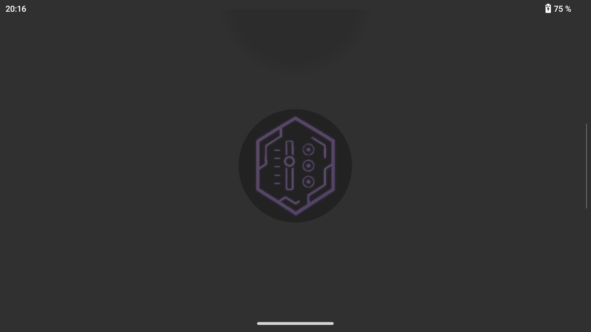
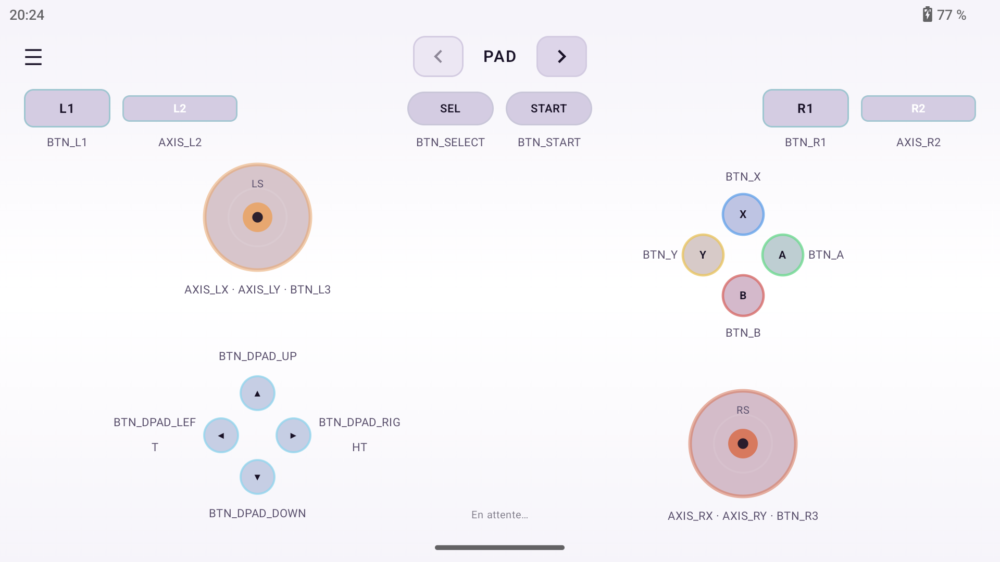
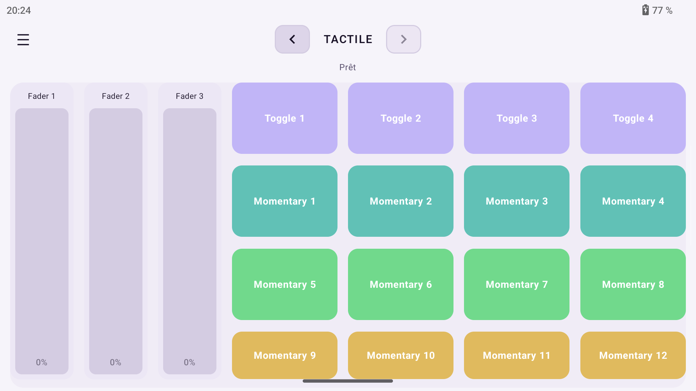
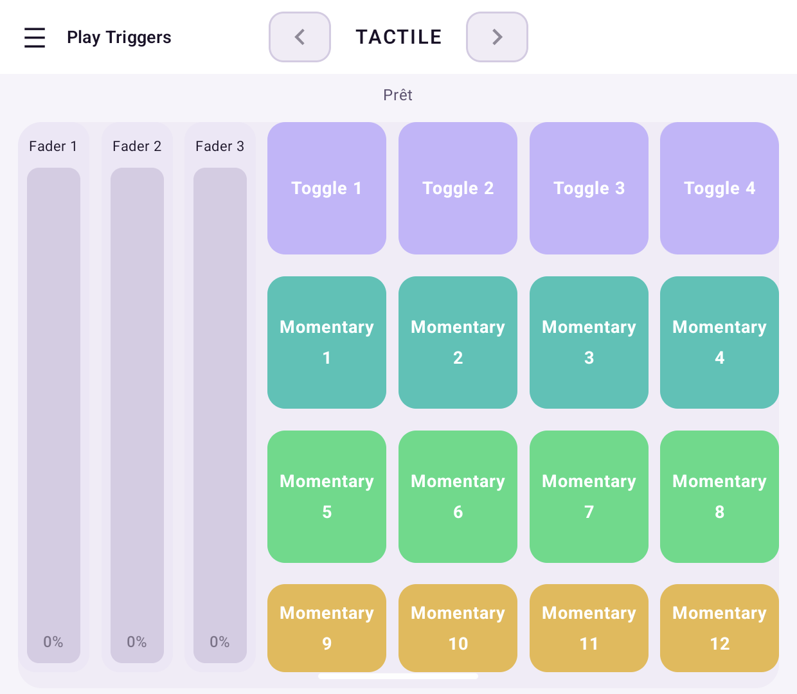
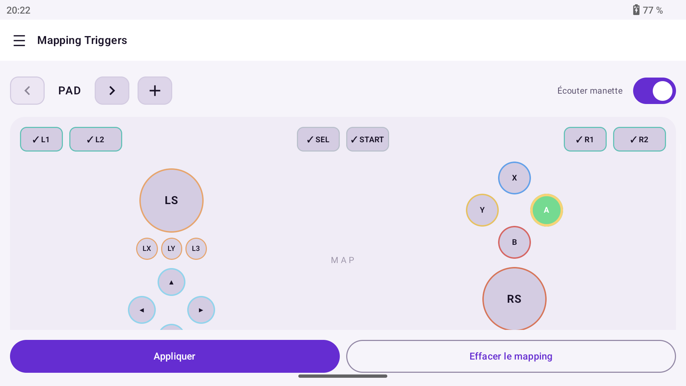
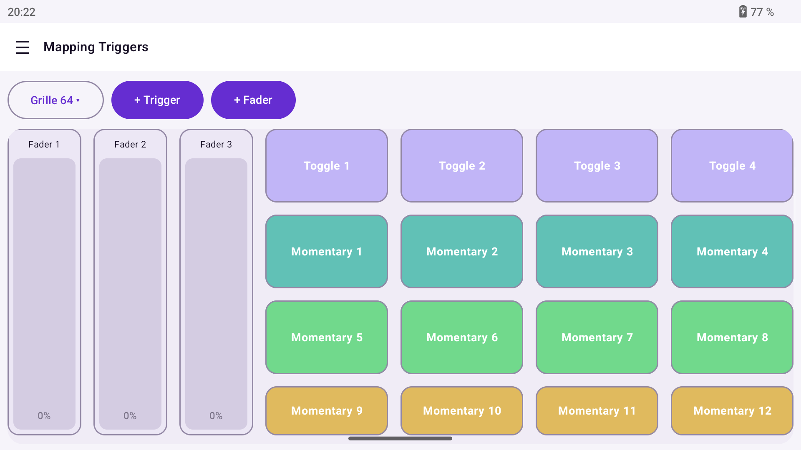
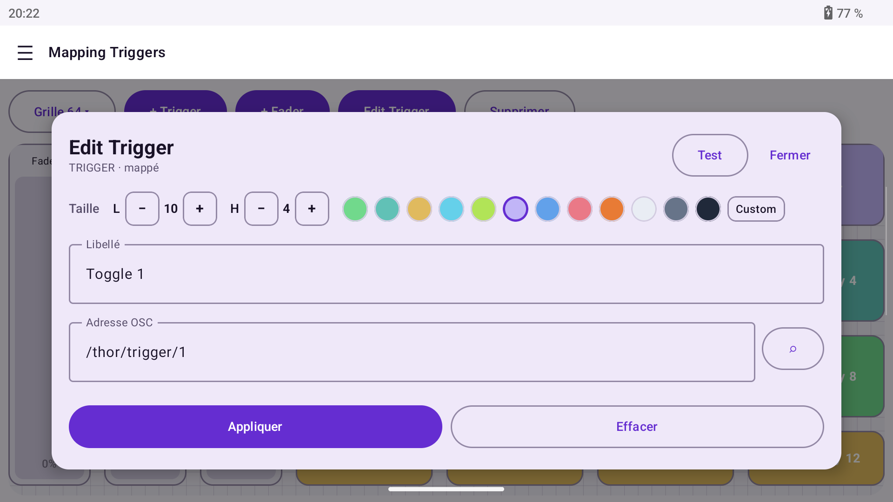
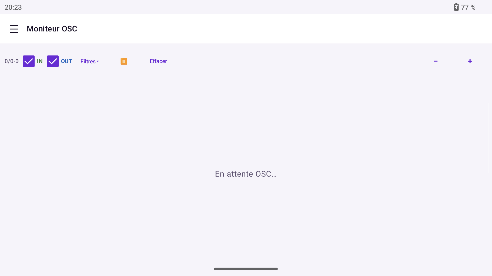
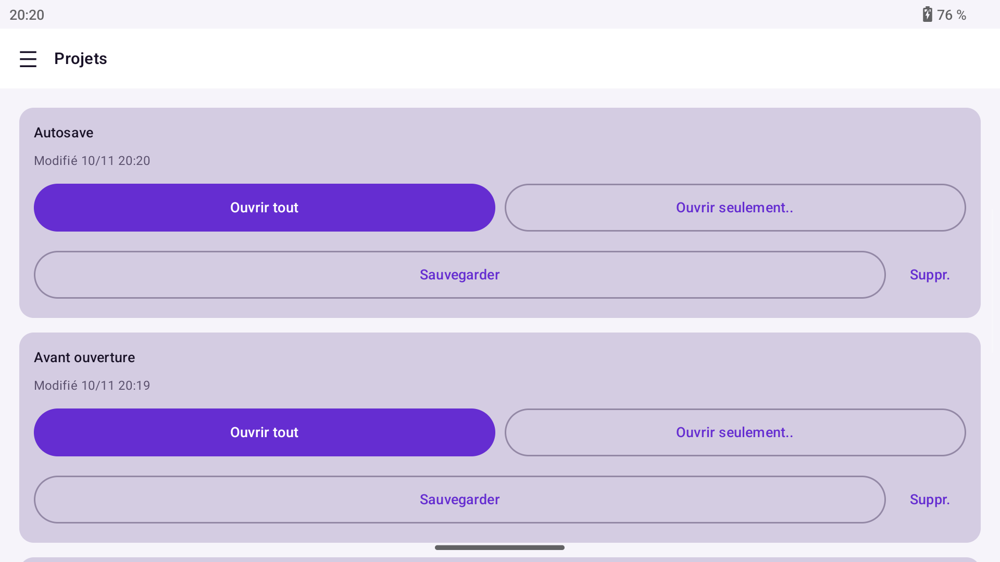
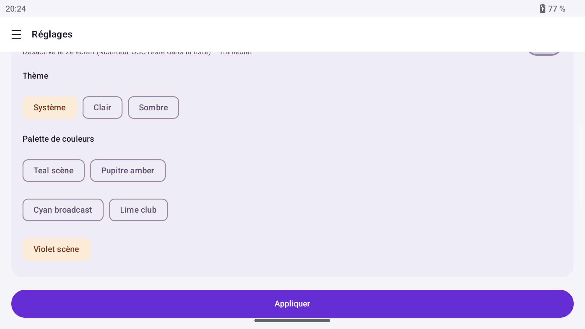

# Gaming Handheld OSC Controller

Contrôleur OSC natif (Kotlin / Jetpack Compose) pour handheld gaming Android à double écran — conçu et validé sur **AYN Thor**. Manette physique + pages tactiles, mapping OSC UDP, projets nommés, moniteur OSC / NDI.

**Version :** 1.0.0 · **Package :** `com.mareg74.osccontroller` · **Licence :** [Apache-2.0](LICENSE)

**Code : Mareg74 · Assisté par Cursor**


Native Kotlin/Compose OSC controller for dual-screen Android gaming handhelds — designed and validated on the **AYN Thor**. Physical gamepad + tactile pages, UDP OSC mapping, named projects, OSC / NDI monitors.

**Version:** 1.0.0 · **Package:** `com.mareg74.osccontroller` · **License:** [Apache-2.0](LICENSE)

**Code: Mareg74 · Assisted by Cursor**


---

## Captures / Screenshots

| | |
|:---:|:---:|
|  |  |
| *Splash* | *Play — Pad* |
|  |  |
| *Play — Tactile* | *Play — écran bas (dual)* / *bottom display* |
|  |  |
| *Mapping — Pad* | *Mapping — Tactile (template)* |
|  |  |
| *Edit Trigger* | *Moniteur OSC* / *OSC Monitor* |
|  |  |
| *Projets* / *Projects* | *Réglages — thème & palette* |

---

## Français

### Présentation

Application Android landscape pour piloter un logiciel OSC (ex. Resolume Arena) depuis un handheld type Thor :

- **Play Pad** — disposition manette (ABXY, sticks, L1/R2, D-pad) avec légendes OSC
- **Play Tactile** — grille de triggers / faders tactile (template inclus)
- **Mapping** — éditeur visuel Pad + éditeur libre Tactile (grille, taille, couleur, adresse OSC)
- **Projets** — sauvegarde / ouverture / import-export de configs nommées
- **Moniteur OSC** — journal IN/OUT UDP
- **Moniteur NDI** — aperçu source NDI (SDK licencié optionnel)
- **Dual screen** — UI principale + présentation sur l’écran bas

### Fonctionnalités

- Mapping boutons **Momentary / Toggle** (payloads INT) et axes **FLOAT** (min/max, courbes)
- Template **Nouveau projet → Template basique** : Pad + Tactile (3 faders + grille 4×4), adresses `/thor/…`, grille 64, palette Violet scène
- Feedback OSC (écoute UDP) pour allumer les contrôles
- Thèmes Clair / Sombre / Système + palettes de couleurs
- Confirmation avant suppression de projet ; le projet ouvert ne peut pas être supprimé

### Prérequis

- Handheld Android **API 26+** (arm64-v8a / armeabi-v7a), idéalement dual-screen type AYN Thor
- Réseau local vers la machine OSC (Resolume, etc.)
- Pour NDI : **NDI SDK Advanced for Android** (licencié, non inclus — voir ci-dessous)

### Installation (APK)

1. Téléchargez `Gaming-Handheld-OSC-Controller-1.0.0.apk` depuis la [Release v1.0.0](https://github.com/Mareg74/Gaming-Handheld-OSC-Controller/releases/tag/v1.0.0)
2. Autorisez l’installation depuis une source inconnue si besoin
3. Installez et lancez **OSC Controller**

```bash
adb install -r Gaming-Handheld-OSC-Controller-1.0.0.apk
```

### Compilation

```bash
export JAVA_HOME=/opt/homebrew/opt/openjdk@17/libexec/openjdk.jdk/Contents/Home   # macOS Homebrew example
./gradlew :app:assembleDebug
adb install -r app/build/outputs/apk/debug/app-debug.apk
```

- Android SDK 34, NDK `26.1.10909125` (ou ajuster `ndkVersion` dans `app/build.gradle.kts`)
- `applicationId` / namespace : `com.mareg74.osccontroller`

### Utilisation rapide

1. **Réglages** → IP / ports OSC (sortie + écoute feedback), **Appliquer**
2. **Projets** → **Nouveau projet** → **Template basique** (ou Vide)
3. **Play** → page **PAD** (manette) ou **TACTILE** (touches)
4. **Mapping Triggers** → éditer adresses, modes, couleurs ; **Test** depuis Edit Trigger
5. **Moniteur OSC** → vérifier les messages IN/OUT

Sur dual screen, l’écran bas suit Play / Mapping selon le mode présentation de l’app.

### OSC & Resolume

- Sortie UDP vers l’IP/port configurés (défaut souvent `7000`)
- Feedback : dans Resolume, OSC output vers l’IP du Thor et le **port écoute** (défaut `7001`)
- Template : `/thor/trigger/N`, `/thor/fader/N`, `/thor/BTN_…`, `/thor/AXIS_…`

### NDI (optionnel)

Le SDK NDI Advanced **n’est pas** dans ce dépôt (licence).

1. Installer le SDK sous `third_party/ndi/` jusqu’à obtenir `third_party/ndi/NDI SDK for Android/` (avec `lib/<abi>/libndi.so`)
2. Rebuild : `./gradlew :app:assembleDebug`
3. Sans SDK → le moniteur NDI affiche « SDK indisponible »

### Structure du dépôt

| Chemin | Rôle |
|--------|------|
| `app/` | Application Android (Compose) |
| `docs/screenshots/` | Captures README |
| `docs/superpowers/` | Specs / plans / notes de conception |
| `LICENSE` | Apache-2.0 |

### Licence

Apache License 2.0 — voir [LICENSE](LICENSE).

### Crédits

**Code : Mareg74 · Assisté par Cursor**


AYN Thor, Resolume, NDI et autres marques appartiennent à leurs propriétaires respectifs.

---

## English

### Overview

Android landscape app to drive OSC software (e.g. Resolume Arena) from a Thor-class gaming handheld:

- **Play Pad** — gamepad layout with OSC legends
- **Play Tactile** — touch trigger / fader grid (template included)
- **Mapping** — visual Pad editor + freeform Tactile editor
- **Projects** — named save / open / import-export
- **OSC Monitor** — UDP IN/OUT log
- **NDI Monitor** — optional licensed SDK preview
- **Dual screen** — primary UI + bottom presentation display

### Features

- **Momentary / Toggle** button mappings (INT) and **FLOAT** axes (min/max, curves)
- **New project → Basic template**: Pad + Tactile (3 faders + 4×4 grid), `/thor/…` addresses, grid 64, Violet scène palette
- OSC feedback (UDP listen) to light controls
- Light / Dark / System themes + color palettes
- Delete confirmation; the open project cannot be deleted

### Requirements

- Android **API 26+** handheld (arm64-v8a / armeabi-v7a), ideally dual-screen (AYN Thor)
- LAN path to the OSC host
- For NDI: **NDI SDK Advanced for Android** (licensed, not bundled)

### Install (APK)

1. Download `Gaming-Handheld-OSC-Controller-1.0.0.apk` from [Release v1.0.0](https://github.com/Mareg74/Gaming-Handheld-OSC-Controller/releases/tag/v1.0.0)
2. Allow install from unknown sources if needed
3. Install and launch **OSC Controller**

```bash
adb install -r Gaming-Handheld-OSC-Controller-1.0.0.apk
```

### Build

```bash
export JAVA_HOME=/opt/homebrew/opt/openjdk@17/libexec/openjdk.jdk/Contents/Home   # macOS Homebrew example
./gradlew :app:assembleDebug
adb install -r app/build/outputs/apk/debug/app-debug.apk
```

- Android SDK 34, NDK `26.1.10909125` (or update `ndkVersion` in `app/build.gradle.kts`)
- `applicationId` / namespace: `com.mareg74.osccontroller`

### Quick start

1. **Settings** → OSC IP / ports, **Apply**
2. **Projects** → **New project** → **Basic template** (or Empty)
3. **Play** → **PAD** or **TACTILE** page
4. **Mapping Triggers** → edit addresses, modes, colors; **Test** from Edit Trigger
5. **OSC Monitor** → verify IN/OUT traffic

On dual-screen devices, the bottom display follows Play / Mapping presentation mode.

### OSC & Resolume

- UDP out to the configured IP/port (often `7000`)
- Feedback: Resolume OSC output → Thor IP + **listen port** (often `7001`)
- Template paths: `/thor/trigger/N`, `/thor/fader/N`, `/thor/BTN_…`, `/thor/AXIS_…`

### NDI (optional)

The NDI Advanced SDK is **not** in this repository.

1. Install under `third_party/ndi/` until you have `third_party/ndi/NDI SDK for Android/`
2. Rebuild with Gradle
3. Without the SDK, NDI Monitor shows “SDK unavailable”

### Repository layout

| Path | Role |
|------|------|
| `app/` | Android app (Compose) |
| `docs/screenshots/` | README screenshots |
| `docs/superpowers/` | Design specs / plans / notes |
| `LICENSE` | Apache-2.0 |

### License

Apache License 2.0 — see [LICENSE](LICENSE).

### Credits

**Code: Mareg74 · Assisted by Cursor**


AYN Thor, Resolume, NDI, and other marks belong to their respective owners.

---

## Liens / Links

- Dépôt / Repository: [github.com/Mareg74/Gaming-Handheld-OSC-Controller](https://github.com/Mareg74/Gaming-Handheld-OSC-Controller)
- Releases: [Releases](https://github.com/Mareg74/Gaming-Handheld-OSC-Controller/releases)
- Issues: [Issues](https://github.com/Mareg74/Gaming-Handheld-OSC-Controller/issues)
